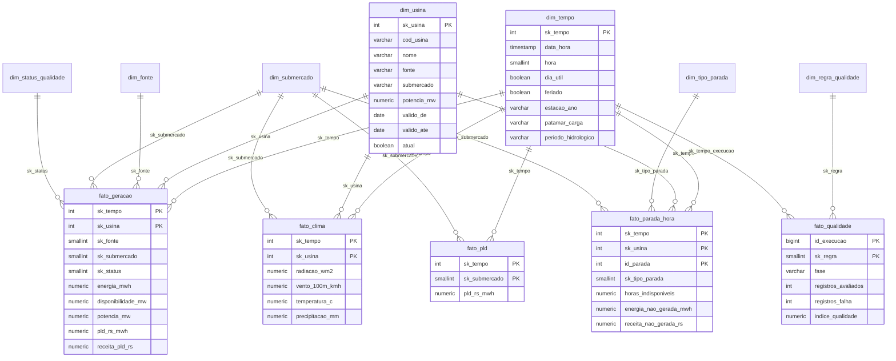
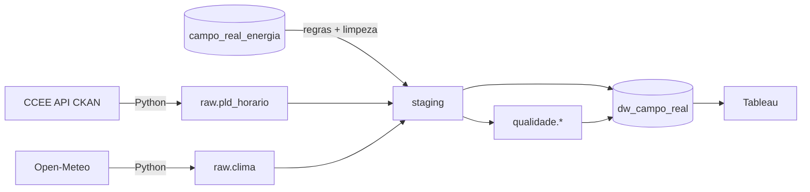

# Documento de modelagem: Data Warehouse Campo Real Energia

Banco: PostgreSQL. Schema do warehouse: `dw_campo_real`. DDL em `sql/03_dw/01_ddl_dw.sql`, carga em `sql/04_carga_dw/`, executada por `python -m src.carga_dw`.

## 1. Camadas

| Schema | Papel |
|---|---|
| `campo_real_energia` | Origem operacional. Somente leitura: nunca é alterada. |
| `raw` | Dado externo exatamente como chegou (JSON): `raw.pld_horario` e `raw.clima`. Log em `raw.log_extracao`. |
| `staging` | Dado tipado, deduplicado e limpo. É a saída das regras de qualidade. |
| `qualidade` | Profiling, métricas por regra, tratamentos, quarentena e impacto antes × depois. |
| `dw_campo_real` | Star schema lido pelo painel. |

## Período dos dados

A dimensão de tempo cobre 2025 e 2026. PLD e clima vão até o último mês carregado de 2026. Geração e paradas existem só em 2025, porque a origem só tem esse ano; por isso receita, preço capturado e perdas são sempre de 2025, e o painel filtra `ano = 2025` nessas análises.

## 2. Matriz de barramento

| Processo de negócio | Tempo | Usina | Fonte | Submercado | Tipo de parada | Status de qualidade | Regra de qualidade |
|---|:-:|:-:|:-:|:-:|:-:|:-:|:-:|
| Geração horária (`fato_geracao`) | X | X | X | X | | X | |
| Preço de curto prazo (`fato_pld`) | X | | | X | | | |
| Clima nas usinas (`fato_clima`) | X | X | | X | | | |
| Indisponibilidade (`fato_parada_hora`) | X | X | | X | X | | |
| Qualidade de dados (`fato_qualidade`) | X | | | | | | X |

`dim_tempo`, `dim_usina` e `dim_submercado` são dimensões conformadas: as mesmas chaves servem a todos os fatos, o que permite cruzar geração, preço, clima e paradas.

## 3. Grão de cada fato (declarado antes da criação)

| Fato | Grão | Medidas |
|---|---|---|
| `fato_geracao` | 1 usina × 1 hora de 2025, para as horas que têm medição depois da limpeza | energia_mwh, disponibilidade_mw, potencia_mw, pld_rs_mwh, receita_pld_rs |
| `fato_pld` | 1 submercado × 1 hora (2025 e 2026 até o último mês publicado) | pld_rs_mwh |
| `fato_clima` | 1 usina × 1 hora de 2025 e 2026 até `open_meteo.data_fim` (ponto Open-Meteo na coordenada da usina) | radiacao_wm2, vento_100m_kmh, temperatura_c, precipitacao_mm |
| `fato_parada_hora` | 1 parada × 1 hora indisponível | horas_indisponiveis, energia_nao_gerada_mwh, receita_nao_gerada_rs |
| `fato_qualidade` | 1 regra × 1 execução (fase ANTES ou DEPOIS da limpeza) | registros_avaliados, registros_falha, percentual_falha, indice_qualidade |
| `fato_impacto_limpeza` | 1 indicador × 1 recorte (fonte ou total) | valor_antes, valor_depois, diferenca, variacao_pct |

Medidas derivadas e por que estão no fato:

- `receita_pld_rs = energia_mwh × PLD da mesma hora no submercado da usina`. É aditiva e responde à pergunta 2 sem obrigar o Tableau a relacionar duas tabelas por chave composta (hora + submercado). `pld_rs_mwh` fica ao lado como contexto da linha.
- `potencia_mw` repetida em cada hora permite somar a energia possível no período e calcular o fator de capacidade com a potência vigente naquela versão da usina.
- `energia_nao_gerada_mwh` em `fato_parada_hora` é a média gerada pela própria usina no mesmo mês e na mesma hora do dia, fora de paradas e sem valores anulados. É uma estimativa e está documentada como tal no painel.

## 4. Diagrama do star schema

Imagem: `docs/diagrama_star_schema.png`. Matriz de barramento em imagem: `docs/matriz_barramento.png`.

## 5. Dimensões

**dim_tempo** (grão horário, `sk_tempo = yyyymmddhh`, 2025 e 2026). Construída pelo grupo com `generate_series`.

| Atributo | Regra |
|---|---|
| dia_util | Segunda a sexta e não é feriado nacional. Ponto facultativo conta como dia útil. |
| feriado / nome_feriado | `feriado_nacional` da origem (2025) + feriados de 2026 incluídos pelo grupo no script de carga, porque o PLD vai até 2026. |
| estacao_ano | Datas astronômicas do hemisfério sul: verão 21/12, outono 20/03, inverno 21/06, primavera 22/09. |
| periodo_hidrologico | Úmido (dez a abr) e seco (mai a nov), como no planejamento do SIN. |
| safra_cana | Abril a novembro, usado para ler a biomassa. |
| patamar_carga | Convenção do grupo inspirada nos patamares do ONS: **Pesado** 18h–20h em dia útil; **Leve** 0h–6h em qualquer dia, domingos e feriados; **Médio** no resto. |
| faixa_horaria | Madrugada, manhã, tarde, noite. |

**dim_usina** carrega fonte e submercado desnormalizados (nome legível no painel), mas os fatos também guardam `sk_fonte` e `sk_submercado`. Assim a fonte e o submercado viram filtros comuns entre fatos que não têm usina (`fato_pld`). Optamos por dimensões separadas porque submercado é compartilhado com o preço e fonte é o eixo da pergunta 3.

**dim_status_qualidade** (dimensão de status): OK, CORRIGIDO, SINALIZADO, ANULADO. Permite ao painel mostrar quanto da receita vem de dado corrigido ou sinalizado.

**dim_regra_qualidade**: regra, dimensão de qualidade, tabela avaliada e decisão.

**dim_tipo_parada**: Programada e Forçada. O motivo fica no fato como atributo degenerado, porque é texto livre.

## 6. Chaves substitutas e membro desconhecido

Toda dimensão tem chave substituta inteira e uma linha `-1` ("Desconhecido"). A carga dos fatos usa `LEFT JOIN` e `COALESCE(sk, -1)`, então um registro sem correspondência nunca some do total: aparece como "Desconhecido" e pode ser investigado. A chave natural (`cod_usina`) fica apenas na dimensão. O fato guarda a chave substituta, que aponta para a versão certa da usina no tempo.

## 7. Mudanças no cadastro (SCD)

`dim_usina` é **SCD tipo 2**. Atributos rastreados: nome, fonte, submercado, UF, município, coordenadas, potência, início de operação e situação, combinados num hash MD5.

Justificativa:

- **Potência:** o fator de capacidade e a energia possível de 2025 têm de usar a potência que a usina tinha em 2025. Sobrescrever (tipo 1) mudaria indicadores históricos sem que a geração tenha mudado.
- **Situação:** uma usina desativada em 2026 continua tendo gerado em 2025.
- **Nome:** um nome novo não deve apagar o nome com que a usina aparece em relatórios antigos.

Funcionamento (`sql/04_carga_dw/01_dimensoes.sql`):

- A primeira versão vale de 1900-01-01 a 9999-12-31.
- Quando o hash muda, a versão atual é fechada na véspera e uma nova versão começa na data da carga.
- Os fatos buscam a versão vigente na data da hora medida.

Isso foi testado alterando a potência de uma usina na staging: nasce a versão 2, e as 8.760 horas de 2025 continuam ligadas à versão 1.

`dim_fonte` e `dim_submercado` são tipo 1: são domínios estáveis, e correções de descrição podem sobrescrever.

## 8. Granularidades diferentes

| Dado | Grão original | Como entra no modelo |
|---|---|---|
| Medição | usina × hora | Grão base de `fato_geracao`. |
| PLD | submercado × hora | `fato_pld` próprio, ligado pela mesma `dim_tempo` e por `dim_submercado`. A receita é calculada na carga ligando a hora da medição com o PLD da mesma hora no submercado da usina. |
| Clima (Open-Meteo, 2025 e 2026) | ponto (lat, lon) × hora | Uma requisição por usina, na coordenada **tratada** da usina, por isso a associação é 1 ponto = 1 usina. Para chegar ao submercado, agrega-se pela `sk_submercado` gravada no fato. Se a fonte fosse uma estação do INMET, a associação seria pela estação mais próxima (distância haversine), e a distância ficaria registrada. |
| Paradas | intervalo (início, fim) | Explodido em horas (`generate_series`) para cruzar com geração e PLD no mesmo grão. |
| Cadastro | estado atual | Dimensão SCD 2. |
| Feriados | dia | Atributo da `dim_tempo` (todas as horas do dia herdam). |
| Qualidade | regra × execução | Fato próprio, ligado à `dim_tempo` pela hora da execução. |

## 9. Fluxo

## 10. Contrato com as outras etapas

A carga do DW (`src/carga_dw.py`) confere as tabelas abaixo antes de começar e para com uma mensagem clara se alguma faltar.

| Tabela | Etapa responsável | Colunas usadas |
|---|---|---|
| `staging.pld_horario` | Extração (Gabi) | cod_submercado, data_hora, pld_rs_mwh |
| `staging.clima_horario` | Extração (Gabi) | cod_usina, data_hora, radiacao_wm2, vento_100m_kmh, temperatura_c, chuva_mm |
| `staging.usina` | Qualidade (Biel) | cod_usina, nome, cod_fonte, cod_submercado, uf, municipio, latitude, longitude, potencia_mw, data_inicio_operacao, situacao, flags_qualidade |
| `staging.parada_usina` | Qualidade (Biel) | id_parada, cod_usina, inicio, fim, tipo, motivo |
| `staging.medicao_geracao` | Qualidade (Biel) | cod_usina, data_hora, energia_mwh, disponibilidade_mw, status_qualidade (OK, CORRIGIDO, SINALIZADO, ANULADO), flags_qualidade |
| `qualidade.execucao`, `qualidade.metricas`, `qualidade.impacto_limpeza` | Qualidade (Biel) | opcionais: sem elas, `fato_qualidade` e `fato_impacto_limpeza` ficam vazios e a carga avisa |
